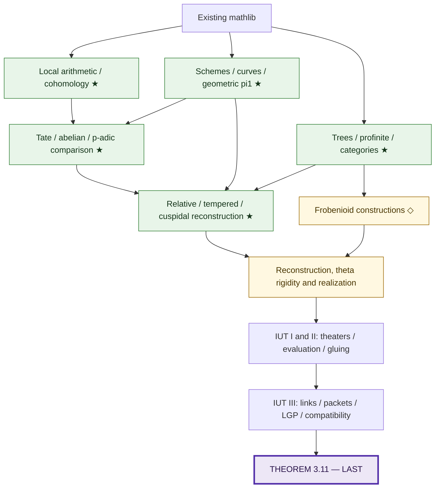

# A Lean formalization plan for IUT III Theorem 3.11

Build reusable arithmetic and anabelian geometry libraries in parallel, then formalize the constructions of IUT I–III and finish with **IUT III, Theorem 3.11**.

The plan selects results from papers and books rather than formalizing entire references. Theorems marked **★ REUSABLE** are intended to be useful beyond IUT. Every package will have a concrete deliverable, prerequisite interfaces and an acceptance criterion.

## The architecture

The detailed plan has **31 work packages**, **42 source cards** and explicit staged outputs for the major shared interfaces. It separates definitions, reusable theorem proofs, IUT assembly and final integration. The [reusable result catalogue](plan/reusable-results.md) marks concrete early releases with uses outside IUT.

## Navigation

- [Roadmap and parallel workstreams](plan/roadmap.md)
- [Graph of papers and books](graphs/sources.md)
- [Work-package dependency graph](graphs/work-packages.md)
- [Package directory](work-packages/README.md)
- [Sources and precise targets](sources/README.md)
- [Reusable mathematics](plan/reusable-results.md)
- [Mathlib baseline](plan/mathlib-baseline.md)
- [The final theorem and its clause-by-clause prerequisites](plan/theorem-3-11.md)
- [Audit and integration gates](tracking/audit-gates.md)
- [Contribution and completion standards](CONTRIBUTING.md)

This repository is a plan, not a claim that the mathematics has already been formalized. Its scope ends at Theorem 3.11; Corollary 3.12 and IUT IV are outside the target.

## Start contributing

Choose an output from the [first parallel assignments](plan/roadmap.md#first-parallel-assignments), agree on its [interface](plan/interfaces.md), and lock its selected [source item](sources/README.md). The full Theorem3.11 proof is the final integration milestone; the [clause matrix](plan/theorem-3-11.md) specifies what earlier work must supply.

The source survey includes precise theorem targets where checked and owned source-closure tasks where deeper proof inputs or corrected hypotheses still need matching. Those open tasks are part of the high-level plan, rather than assumed mathematical facts. See the [review and validation record](reviews/README.md).
