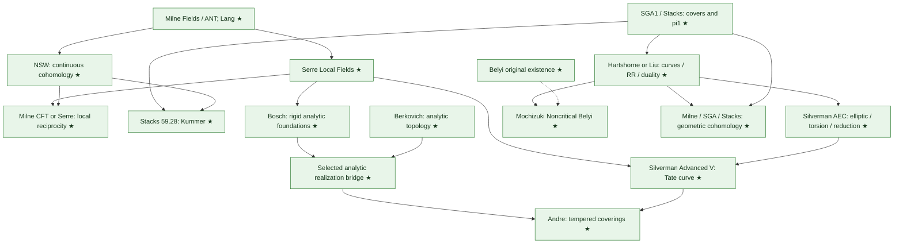
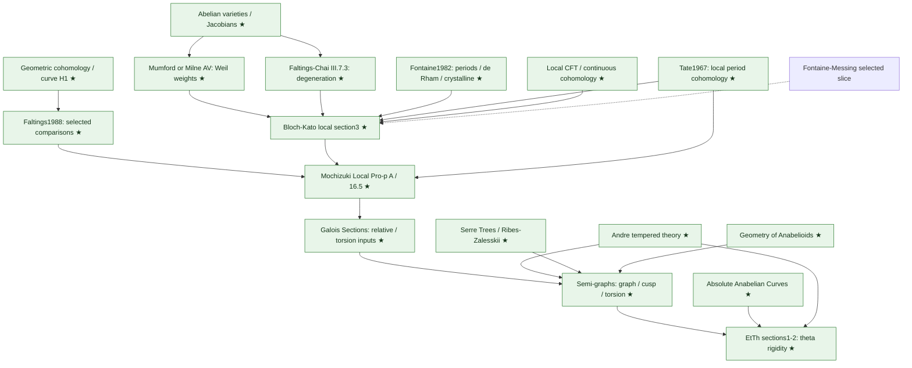
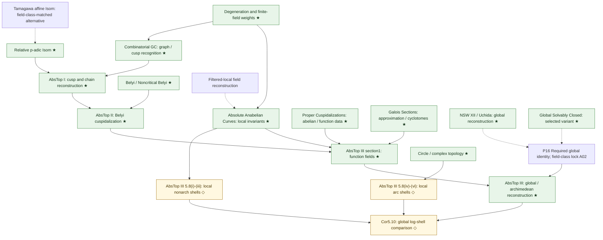
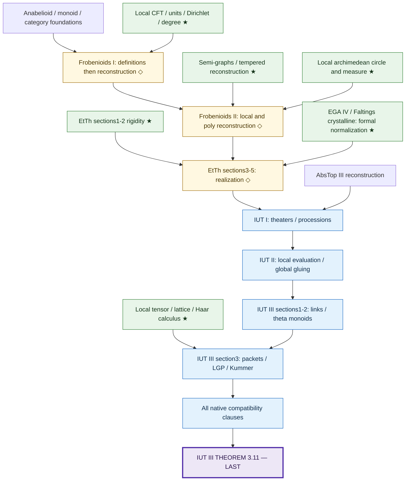

# Graph of papers and books

This is a graph of **selected outputs from sources**. An arrow means the prerequisite output is used by the consuming mathematical construction or selected proof route. It is not an instruction to formalize an entire text first. Dotted arrows mark alternatives or still-to-be-locked source routes. The [work-package graph](work-packages.md) gives the actual parallel schedule and staged joins.

**★** = useful beyond IUT; **◇** = specialized support. All source names below link through the [source catalogue](../sources/README.md). Different panels repeat a source when it exports independent results. No publication-date ordering is implied.

## Field, curve and analytic foundations

Milne/Serre/NSW are overlapping references for selected standard results. The proof-route lock chooses compatible proofs; it does not count every exposition as a separate mandatory project. The [field](../sources/foundations/field-number-theory.md), [CFT](../sources/foundations/class-field-theory.md), [curve](../sources/foundations/algebraic-curves.md) and [analytic](../sources/foundations/rigid-analytic-foundations.md) cards state the selections.

## Comparison and relative/tempered anabelian geometry

The Fontaine–Messing edge is a proof-selection question within the retained local comparison slice. The [Fontaine](../sources/foundations/fontaine-period-rings.md) card owns its resolution. The Isom-only specialization of the relative Hom route is allowed only after checking every retained caller and its additional localization/torsion inputs.

## Cuspidalization and field reconstruction

The global identity node requires a field-class-matched proof; the ordinary number-field theorem and solvably closed variant are not asserted interchangeable. The two source-number mismatches in the global/abelian-cuspidalization callers must be reconciled under A02. Filtered-local and affine alternatives are not substitutes for every relative, global or tempered theorem. The [scope-boundary card](../sources/anabelian/alternatives-and-boundaries.md) records this distinction.

## Categorical arithmetic, corrected models and the IUT endpoint

The EGA/Faltings crystalline-paper inputs are selected normalization/model assertions requested by the later EtTh corrections, not permission to identify a formal ringed space with a rigid/Berkovich generic fiber without proof. Their source cards and P08/P20 own the exact interpretation bridge.

[Home](../README.md) · [All source cards](../sources/README.md) · [Output schedule](work-packages.md) · [Audit gates](../tracking/audit-gates.md)
