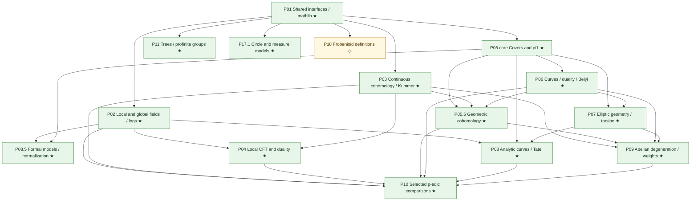
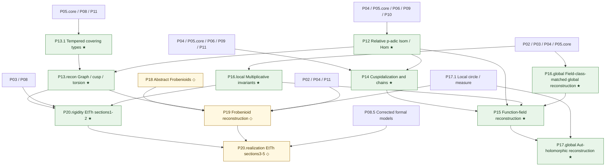
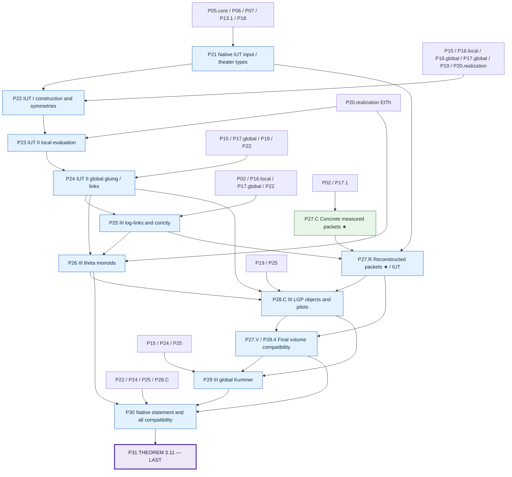

# Dependency graph for parallel work

Arrows mean **proved prerequisite output → consuming output**. Nodes split a few packages into early definitions/concrete mathematics and later reconstruction/compatibility results. This is the scheduling graph; a source book or paper is never a single all-or-nothing barrier.

**★** marks useful mathematics beyond IUT. **◇** marks specialized support. Colored IUT nodes are source-specific assembly; **P31 is the unique final sink**. Nodes represent planned deliverables, not completed proofs.

## From existing mathlib to reusable geometry

P05.core releases without the later cohomology output. Curve/coherent work in P06 and generic sheaf/cohomology work can develop in parallel; the geometric curve comparison P05.6 joins them only when its consumers need it.

## Anabelian and categorical reconstruction

P16's global branch owns the additional global class-field/cohomological/density leaves selected by its proof audit. P19 needs local archimedean models from P17.1, not completion of P17.global. Within P19/P20, abstract reconstruction, analytic theta and their eventual realization can be worked on by separate teams.

## IUT assembly and the last theorem

This graph separates **P27.C → P27.R → P28.C → P27.V**. It does not put the complete later log-volume compatibility theorem upstream of its own LGP input. The output types and earlier concrete lemmas can be shared long before this final join.

## Read the graphs as contracts

Grouped boundary nodes name imported outputs already shown in another panel; they are not new mathematical tasks. The [package directory](../work-packages/README.md) and [interface guide](../plan/interfaces.md) define their exact scope. The [audit gates](../tracking/audit-gates.md) are required before acceptance but do not insert new axioms into the graph.

[Home](../README.md) · [Parallel assignments](../plan/roadmap.md#first-parallel-assignments) · [Papers/books graph](sources.md)
