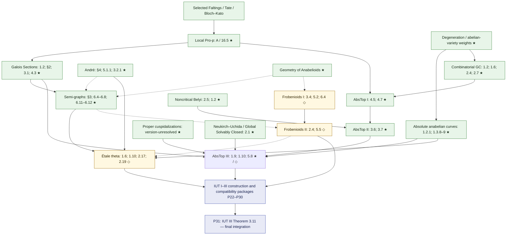

# Anabelian geometry and Frobenioid source graph

This directory assigns **selected results**, rather than whole-paper transcription, to the [work packages](../../plan/package-contract.md). Each card separates a source theorem whose target was inspected from a caller's citation and a proposed implementation choice. The complete proof dependency closure remains subject to [audit gates](../../tracking/audit-gates.md).

**★ REUSABLE** marks independent arithmetic/anabelian library results. **◇ IUT SUPPORT** marks specialized infrastructure with possible independent applications. **IUT SPECIFIC** marks the final IUT assembly; that assembly is outside these source cards. A star is a usefulness judgment, never a proof-status claim.

## Selected source routes

Solid arrows below are selected mathematical import/caller routes. Dashed arrows are foundational construction interfaces whose exact result lists still require a source audit. They do not distinguish “already in Lean” from “to prove”: use the [mathlib baseline](../../plan/mathlib-baseline.md) and individual packages for that. A paper node groups several outputs, so an arrow does **not** require finishing the whole paper before its consumer starts.

At theorem level, the comparison route into Semi-graphs can use an **Isom specialization** where proved sufficient. The full Hom theorem remains an optional broader milestone until each other caller is checked. The local Galois-invariant package, the global Neukirch–Uchida theorem, and the relative curve theorem have distinct input contracts.

## Source cards and handoffs

| Source | First deliverables | Package / usefulness |
|---|---|---|
| [Local Pro-p Anabelian Geometry](local-pro-p.md) | Required relative hyperbolic-curve Isom, with A/16.5 as printed baseline | P12 · ★ REUSABLE |
| [Galois Sections](galois-sections.md) | Relative localization; approximation; cyclotome synchronization | P12/P13/P15 · ★ REUSABLE |
| [André tempered coverings](andre-tempered.md) | Tempered-group construction, completion comparison, arithmetic exact sequence, normalizer lemma | P08/P11/P13 · ★ REUSABLE |
| [Geometry of Anabelioids](geometry-anabelioids.md) | Group/category dictionary, slimness and selected localizations | P01/P05/P13 · ★ REUSABLE |
| [Semi-graphs of Anabelioids](semi-graphs.md) | Graph/cusp/torsion-point reconstruction and relative tempered comparison | P13 · ★ REUSABLE |
| [Absolute Anabelian Geometry of Hyperbolic Curves](absolute-anabelian-curves.md) | Local multiplicative invariants, arithmetic kernels, cusps; selected global absolute Isom | P13/P16 · ★ REUSABLE |
| [Combinatorial GC](combinatorial-gc.md) | Cusp/graph recognition from the specified group/action data | P11/P14 · ★ REUSABLE |
| [AbsTop I](abstop-i.md) | Corrected cusp recognition and conditional chain reconstruction | P14 · ★ REUSABLE |
| [Noncritical Belyi Maps](noncritical-belyi.md) | Prescribed finite-set Belyi theorem and Zariski-basis corollary | P06 · ★ REUSABLE |
| [AbsTop II](abstop-ii.md) | Belyi-chain construction and cuspidal group reconstruction | P14 · ★ REUSABLE |
| [Proper Cuspidalizations](proper-cuspidalizations.md) | Maximal cuspidally abelian reconstruction and Kummer/function bridge | P14/P15 · ★ REUSABLE; version unresolved |
| [AbsTop III](abstop-iii.md) | Function fields, normalized local multiplicative invariants, global/archimedean reconstruction | P15/P16/P17 · ★ REUSABLE; later shells ◇ IUT SUPPORT |
| [Global Solvably Closed / Neukirch–Uchida](global-solvably-closed.md) | Number-field outer-Isom theorem; solvably closed variant only if needed | P16 · ★ REUSABLE; caller numbering unresolved |
| [Frobenioids I](frobenioids-i.md) | Definitions; general reconstruction; arithmetic degree and its scale | P18/P19 · ◇ IUT SUPPORT |
| [Frobenioids II](frobenioids-ii.md) | Local Kummer/reciprocity, archimedean instances, poly-Frobenioid reconstruction | P18/P19 · ◇ IUT SUPPORT |
| [Étale theta](etale-theta.md) | Analytic theta, cyclotomic/discrete/constant-multiple rigidity, categorical realization | P20 · ★ REUSABLE rigidity / ◇ realization |
| [Alternatives and scope boundaries](alternatives-and-boundaries.md) | Filtered local theorem; selected Tamagawa alternatives/lemmas; Jarden–Ritter boundary | Choice-dependent, with owners P12/P13/P14/P16 |

The [foundation source cards](../foundations/README.md) account separately for standard books/papers on fields, class field theory, étale π₁, curves, elliptic/Tate curves, abelian varieties, p-adic comparison and profinite/tree theory. Select one compatible proof route per interface rather than treating overlapping textbooks as additive whole-book tasks.

## Work that can proceed concurrently

1. **Relative-curve strand:** P10 comparison and P12 curve reconstruction; consumers can develop conditional Isom interfaces immediately.
2. **Tempered strand:** P08 analytic covers and P11 group theory; then graph/torsion reconstruction in P13.
3. **Cuspidal strand:** P06 Belyi/curve cohomology and P09 weights; then P14 chains and cuspidalization.
4. **Field-reconstruction strand:** P04 local reciprocity and P16 global Galois reconstruction; P15 can independently develop divisor/linear-system reconstruction.
5. **Categorical strand:** P18 Frobenioid definitions, abstract P19 reconstruction, and arithmetic/archimedean instantiations.
6. **Theta strand:** P08 analytic theta calculations and P20 rigidity/categorical realization, joining the tempered and Frobenioid outputs.

Temporary conditional interfaces are development tools: the final P31 theorem must have its required prerequisites proved in Lean, with no unclosed mathematical interface assumptions. P31 is the final proof integration, while its statement/interfaces are designed early in P30.

## Evidence and closure rules

Each card uses three grades: **source-target audited** (the original statement was inspected at the cited scope), **caller-audited** (an inspected proof requests that theorem; original matching remains), and **planned/candidate** (an implementation/source selection to verify). Primary-text matches from web PDFs are labeled separately when a corrected page-image audit remains. These grades are research provenance, not Lean verification.

The [author catalogue](https://www.kurims.kyoto-u.ac.jp/~motizuki/papers-english.html) was checked on October 15, 2026. Version-lock tasks include its linked corrections/comments; several add mathematical hypotheses, notably countability for tempered constructions and corrected cusp/Belyi criteria. The two explicit theorem-number discrepancies are owned in [Proper Cuspidalizations](proper-cuspidalizations.md) and [Global Solvably Closed](global-solvably-closed.md). The [audit gates](../../tracking/audit-gates.md) track their resolution and all still-unexpanded proof leaves.

[Project home](../../README.md) · [Package names](../../plan/package-contract.md) · [Reusable milestones](../../plan/reusable-results.md)
