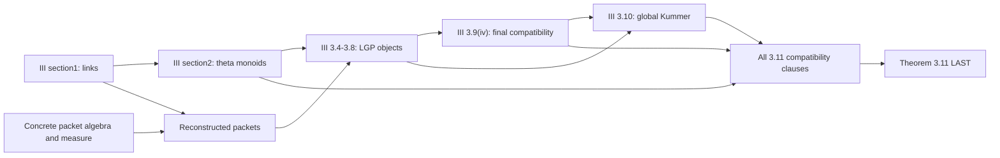

# IUT III: Canonical Splittings of the Log-theta-lattice

**Source:** Shinichi Mochizuki, *Inter-universal Teichmüller Theory III: Canonical Splittings of the Log-theta-lattice*, Publ. RIMS 57 (2021), 403–626. [Author PDF](https://www.kurims.kyoto-u.ac.jp/~motizuki/Inter-universal%20Teichmuller%20Theory%20III.pdf) · [Author catalogue and corrections](https://www.kurims.kyoto-u.ac.jp/~motizuki/papers-english.html).

**Endpoint:** Theorem3.11, printed573–580. The plan stops here; Corollary3.12 and IUT IV are not additional prerequisites merely because they follow or appear in the bibliography.

## Selected targets and owners

| Item | Exact source target | Output | Owner / value |
|---|---|---|---|
| III.1 | Def1.1; Props1.2–1.3; Def1.4; Thm1.5 | Log-shell/link construction and lattice; vertical, horizontal and bi-coricity | P25; IUT SPECIFIC |
| III.2 | Prop2.1, especially(ii),(iii),(vi); Thm2.2; Cor2.3; Def2.4 | Vertically coric theta monoids, mono-theta projective systems, etale-picture symmetry, split-subquotient strips | P26; IUT SPECIFIC |
| III.3 | Props3.1–3.3; concrete algebra/measure content of Prop3.9 and Rem3.1.1 | Tensor-product field decompositions, integral structures, measured packets and normalized degree/volume | P27.C/R; ★ REUSABLE for the standalone mathematics |
| III.4 | Props3.4–3.5; Ex3.6; Prop3.7(i)–(v); Def3.8; Rem3.8.2 | Local/global LGP/lgp Frobenioids, splitting monoids, Kummer comparisons and pilots | P28.C; IUT SPECIFIC |
| III.5 | Prop3.9(ii)–(iv), with exact local-degree, procession and archimedean normalization | Reconstruction and log-link compatibility of the prescribed volumes | P27.V / P28.4; standalone measure lemmas ★ REUSABLE |
| III.6 | Prop3.10(i)–(iii); Rem3.10.1 | Global Kummer, all-place non-interference, MOD/mod distinction and total log-link precomposition | P29; IUT SPECIFIC |
| III.7 | All clause-level naturality/compatibility assertions in Thm3.11(i)–(iii); interpretation supplied by Remarks3.11.1–3.11.4 | Exact output groupoids, Ind1–3, automorphism-equivariance and Kummer/evaluation squares | P30; IUT SPECIFIC |
| III.8 | **Thm3.11** | **Final Lean theorem assembled from all earlier completed exports** | **P31; last** |

## Dependency refinement

This separates the early packet algebra from the final volume theorem. It avoids treating all of section3 as one circular package.

## Precision and source use

The [clause matrix](../../plan/theorem-3-11.md) enumerates direct references from printed573–580 and their work-package owners. It includes references to IUT I/II, both local and archimedean branches, and the distinction between exact compatibility and one-sided inclusion/surjection. A03 and A08 close remaining proof-interpretation and clause-level edges.

No English assertion that a construction is “immediate,” “formal” or “functorial” counts as a completed Lean proof. The explicit maps, quotient actions, reconstruction models and naturality laws must be implemented and checked at their actual hypotheses.

[All sources](../README.md) · [P25–P31](../../work-packages/README.md) · [Final theorem specification](../../plan/theorem-3-11.md)
